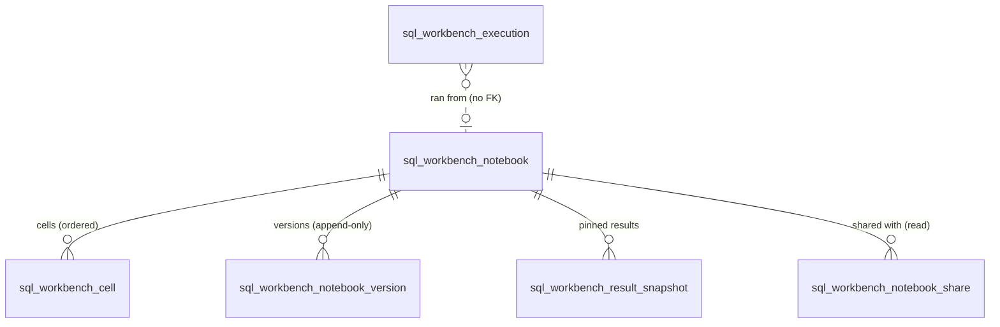

# SQL Workbench QBit: design

Status: accepted for 1.0 (owner decisions 2026-10-11). Built against QQQ 4.1.0-RC.2 and Next UI 1.0.0-RC.11.

SQL Workbench is a super-user SQL notebook for any QQQ application. Users write SQL (and markdown) in notebook cells, run it against any RDBMS backend of the instance, and see typed, paged, exportable results, quick charts, and visual EXPLAIN plans. Sessions are **read-only by default**. A separate permission unlocks a **gated write mode** with per-run confirmation, a dry run, and an affected-row guard. **Every execution is audited.**

- Maven: `com.kingsrook.qbits:qbit-sql-workbench`, package `com.kingsrook.qbits.sqlworkbench`
- QBit identity: `com.kingsrook.qbits:sql-workbench`
- REST: `/qqq/v1/sql-workbench/*`
- UI: Next UI widget type `SQL_WORKBENCH`, rendered on the qbit's app page (`/app/sqlWorkbench`)

---

## 1. Goals and non-goals

### Goals
1. Run SQL from the browser against any QQQ RDBMS backend: Postgres, MySQL, SQLite, H2.
2. Notebooks: ordered SQL and markdown cells, named `:parameters`, version history, pinned result snapshots. Notebooks are personal by default and can be published to a shared library.
3. An editor with formatting, syntax highlighting per dialect, and autocomplete from live schema metadata plus QQQ table and field names.
4. Results: a typed grid (sort, page, copy), CSV/XLSX/JSON export, quick charts, and an EXPLAIN plan tree.
5. Safe by construction:
   - Read-only transactions by default.
   - Write mode behind a separate permission plus a confirmation flow.
   - Hard limits on time, rows, and bytes.
   - No session-state leakage.
   - A complete audit trail.

### Non-goals (1.0)
- Not a DBA console. There are no long-running jobs, background queries, or result sets larger than the configured cap.
- No QQQ record-level security. **SQL Workbench executes raw SQL. It does not apply QQQ record security locks, table permissions, field hiding, or record locks.** That is why it is super-user only (see §6).
- Non-RDBMS backends (memory, filesystem, API, MongoDB) are out of scope.
- No collaborative real-time editing. The last save wins, and every save creates a version.

---

## 2. Architecture

```
 Next UI (qqq-frontend-next)                          QQQ application (host)
 ┌──────────────────────────────────┐                 ┌────────────────────────────────────────────┐
 │ /app/sqlWorkbench  (AppHome)     │  GET metaData   │ QQQ middleware (Javalin 7)                 │
 │  └ WidgetRenderer                │◄───────────────►│  /qqq/v1/metaData  (app + widget, filtered │
 │     case 'SQL_WORKBENCH'         │                 │                    by sql_workbench.hasAccess)│
 │      └ SqlWorkbenchWidget (lazy) │                 │                                            │
 │         ├ NotebookList           │  /qqq/v1/       │ SQL Workbench endpoint specs               │
 │         ├ NotebookEditor         │  sql-workbench/*│  └ SqlWorkbenchApi (session, perms, JSON)  │
 │         │  ├ SqlCell (CM6)       │◄───────────────►│     ├ SqlExecutionEngine ──► ConnectionMgr │
 │         │  ├ MarkdownCell        │                 │     │   ├ SqlClassifier / NamedParameterSql│
 │         │  ├ ResultGrid/Export   │                 │     │   ├ SessionGuard (RO txn, timeouts)  │
 │         │  ├ QuickChart          │                 │     │   ├ ResultCollector (limits, types)  │
 │         │  └ PlanTree            │                 │     │   └ ResultCache / RunningStatements  │
 │         ├ WriteConfirmDialog     │                 │     ├ ExplainService ─► PlanParser         │
 │         └ HistoryPanel           │                 │     ├ SchemaIntrospector (cached)          │
 │ src/lib/api/sql-workbench.ts     │                 │     ├ NotebookService (QQQ actions)        │
 └──────────────────────────────────┘                 │     └ ExecutionAuditor (QQQ actions)       │
                                                      │ qbit tables on the host's backend          │
                                                      │ target RDBMS backends (any in instance)    │
                                                      └────────────────────────────────────────────┘
```

### 2.1 Backend qbit components

| Component | Responsibility |
|---|---|
| `SqlWorkbenchQBitConfig` | Host-facing config (§7). Implements `QBitConfig` with list-based, null-safe `validate`, `getDefaultBackendNameForTables`, and `getTableMetaDataCustomizer`. |
| `SqlWorkbenchQBitProducer` | `QBitMetaDataProducer<SqlWorkbenchQBitConfig>`, the same pattern as Quick Search. The default `produce()` registers `QBitMetaData`, runs the component producers in `metadata/`, and stamps `sourceQBitName`. `postProduceActions` builds the `SqlWorkbenchRuntime` and registers the Javalin route provider (when Javalin is on the classpath). `produce(QInstance)` adds everything to the instance (Quick Search compat style). |
| `metadata/*` | The 6 tables with their record locks, joins and child-list widgets, the two security key types, the record actions (Share Notebook, Duplicate Notebook, Restore Version: processes on tables, never in the nav), the `sqlWorkbenchWidget` widget (type `SQL_WORKBENCH`), and the `sqlWorkbench` app (widget plus all six tables). |
| `customizers/*` | Table customizers that keep the notebook invariants for every entry point (notebook UI, table UI, `/qqq/v1` API): ownership, cell order and limits, versions, share keys, library visibility, append-only versions and audit, cascades. |
| `SqlWorkbenchRuntime` | Instance-scoped live state, held transient on the config: result cache, running-statement registry, write-preview tokens, schema cache. |
| `sql/*` | `SqlScanner` (dialect-aware lexer), `SqlClassifier` (split plus classify), `NamedParameterSql`. Pure Java, with no JDBC dependency. |
| `engine/*` | `WorkbenchBackends` (target resolution and connection sourcing), `SqlExecutionEngine` (read-only, preview, commit), `SessionGuard` (per-vendor read-only, timeouts, cleanup), `ResultCollector` (typing and limits), `ResultCache`, `WritePreviewTokens`, `ExecutionAuditor`. |
| `schema/SchemaIntrospector` | JDBC `DatabaseMetaData`: schemas, tables, columns, keywords, and functions, plus the QQQ table/field to SQL name mapping. Cached per backend (TTL). |
| `explain/*` | `ExplainService` (per-dialect EXPLAIN syntax) and `PlanParser`, which normalizes Postgres JSON, MySQL JSON, SQLite `EXPLAIN QUERY PLAN` rows, and H2 text into one `PlanNode` tree. |
| `notebook/NotebookService` | Notebook CRUD, visibility, versions, and snapshots through QQQ actions on the qbit tables. |
| `api/SqlWorkbenchApi` | Transport-agnostic API: map in, map out. Checks permissions and throws QQQ exceptions. Unit-testable without HTTP. |
| `api/SqlWorkbenchEndpoints` and `*Spec` | One `MiddlewareSpecExtension`, `sql-workbench`, at `/sql-workbench`. Twenty JSON specs extend `AbstractJsonEndpointSpec`; export extends `AbstractEndpointSpec` directly. Core sets up and clears the session. The shared JSON transport checks access before parsing and keeps exact decimal parameters and 409 duplicate-execution errors. Existing services retain permission checks, limits and audit. See [UI API contract](UI-API.md). |
| `api/SqlWorkbenchSchemas` | Versioned request and response component schemas, declared once by the capabilities spec for the complete extension. The committed fragment is checked by `SqlWorkbenchApiContractTest`. |

### 2.2 Frontend (Next UI)

The feature is advertised through **app presence**, the same as ESB. `/qqq/v1/metaData` publishes only an allow-list of supplemental metadata, so a flag would not reach the UI. The qbit's app `sqlWorkbench` carries one widget of type `SQL_WORKBENCH`. Both are gated by `sql_workbench.hasAccess`, so users without access never see either one. The generic `/app/[slug]` route renders `AppHome`, then `ConnectedWidget`, then `WidgetRenderer`, which gains:

```tsx
case 'SQL_WORKBENCH': return <SqlWorkbenchWidget widgetMetaData={widgetMetaData} />   // React.lazy
```

The widget ignores its `/widget/{name}` payload. It talks to `/qqq/v1/sql-workbench/*` through typed functions in `src/lib/api/sql-workbench.ts` (axios `apiClient`, TanStack Query keys `queryKeys.sqlWorkbench*`).

Components (`src/components/sql-workbench/`):

| Component | Notes |
|---|---|
| `SqlWorkbenchWidget` | Shell: capabilities query, layout with a notebook list on the left and the editor on the right, `?notebook=<id>` deep link. |
| `NotebookList` | "Mine" and "Shared" tabs, new, duplicate, delete. |
| `NotebookEditor` | Title, default backend, parameters panel, ordered cells (add, move, delete), save (creates a version), publish, versions drawer. |
| `SqlEditor` | CodeMirror 6 (`@codemirror/lang-sql` with `PostgreSQL` / `MySQL` / `SQLite` / `StandardSQL` dialects). Schema completion comes from the schema endpoint, with QQQ table and field names as extra completions that insert the SQL names. Keys: Ctrl/Cmd-Enter runs, Shift-Alt-F formats (`sql-formatter`), Esc then Tab leaves the editor (WCAG 2.1.2). The whole CodeMirror stack is in the lazy chunk. |
| `MarkdownCell` | Edit/preview toggle. Rendered with a minimal safe markdown renderer that escapes HTML. |
| `ResultGrid` | Typed columns. Null renders as a dimmed `NULL`, JSON is pretty-printed in an expandable cell, dates are ISO, binary shows as `<binary N bytes>` plus a hex preview. Server-side sort and paging over the cached result. Copy cell/row/all as TSV. Export CSV/XLSX/JSON (server-generated download). |
| `QuickChart` | Bar, line, or pie from the current page: choose the x column and numeric y columns. Uses recharts, which already ships in Next. |
| `PlanTree` | Collapsible tree of `PlanNode`s with cost, rows, and actual time, plus a relative-cost bar. Raw plan toggle. |
| `WriteConfirmDialog` | Statement preview with kinds, dry-run affected rows, row-guard acknowledgement, and a type-to-confirm field (the backend name). |
| `HistoryPanel` | The user's recent executions (from the audit table): re-open SQL into a cell. |

---

## 3. Data model

Six tables on the host-chosen backend (`config.backendName`). They are standard QQQ tables in the `sqlWorkbench` app, with the usual query, record, edit, export, audit, and developer-mode screens, and record security locks decide who sees which rows (section 6).



 Names can be prefixed (`tableNamePrefix`) or customized (`tableMetaDataCustomizer`, for example snake_case backend names). The Postgres DDL is in [`docs/ddl/postgres.sql`](ddl/postgres.sql). Liquibase users can drop it into a formatted-SQL changeset.

### `sql_workbench_notebook`
| field | type | notes |
|---|---|---|
| id | INTEGER PK | |
| title | STRING(255) | required |
| description | TEXT | |
| ownerUserId | STRING(255) | `QSession.user.idReference`, required |
| ownerName | STRING(255) | display only |
| visibility | STRING(16) | `PERSONAL` or `SHARED`; derived from the shares (`SHARED` while an `ALL` share exists), not editable |
| defaultBackendName | STRING(100) | |
| parametersJson | TEXT | `[{"name","type","defaultValue","label"}]` |
| currentVersion | INTEGER | incremented on every content change, from the notebook UI or the tables |
| createDate, modifyDate | DATE_TIME | |

### `sql_workbench_cell`
| field | type | notes |
|---|---|---|
| id | INTEGER PK | |
| notebookId | INTEGER | FK, PVS to notebook |
| cellKey | STRING(64) | client-stable UUID; snapshots and audit refer to it |
| sortOrder | INTEGER | cells added through the table go last |
| cellType | STRING(16) | `SQL` or `MARKDOWN` |
| title | STRING(255) | |
| content | TEXT | SQL or markdown |
| backendName | STRING(100) | null means the notebook default |
| createDate, modifyDate | DATE_TIME | |

### `sql_workbench_notebook_version`
Append-only history. Each save writes the full notebook plus cells as JSON: a notebook-UI save writes one version; a table edit of the notebook or one of its cells writes one version per change (`NotebookVersioning`, as the system user, after QQQ has authorized the change).
`id, notebookId, versionNumber, contentJson (TEXT), savedByUserId, savedByName, comment, createDate`. Unique key: `(notebookId, versionNumber)`. Retention: `notebookVersionRetention` (default 100 per notebook, oldest pruned on save).

### `sql_workbench_result_snapshot`
Pinned results. Created only by pinning a cached result in the notebook UI (so the data comes from a real run); through the table only `label` can change, and the owner can delete them.
`id, notebookId, cellKey, executionUuid, label, backendName, sqlText (TEXT), resultJson (TEXT: columns plus up to snapshotMaxRows rows), rowCount, truncated, createdByUserId, createDate`.

### `sql_workbench_notebook_share`
Who, besides the owner, may read a notebook (read only; no shared editing).
| field | type | notes |
|---|---|---|
| id | INTEGER PK | |
| notebookId | INTEGER | FK, PVS to notebook; cannot change |
| audienceType | STRING(16) | `USER`, `GROUP`, or `ALL` (the shared library) |
| audienceId | STRING(255) | the user id or group name; null for `ALL` |
| audienceKey | STRING(300) | computed: `user:<id>`, `group:<name>` (lower-cased), or `all`; unique per notebook; what the share locks match |
| createdByUserId, createdByName | STRING(255) | |
| createDate, modifyDate | DATE_TIME | |

Publishing in the notebook UI inserts (or deletes) the `ALL` share; the share customizer keeps the notebook's `visibility` in step.

### `sql_workbench_execution` (audit, append-only)
| field | type | notes |
|---|---|---|
| id | INTEGER PK | |
| executionUuid | STRING(36) | unique; the id the UI uses |
| userId, userName | STRING(255) | |
| backendName | STRING(100) | |
| mode | STRING(24) | `READ_ONLY`, `WRITE_PREVIEW`, `WRITE_COMMIT`, `EXPLAIN`, `EXPLAIN_ANALYZE` |
| status | STRING(16) | `RUNNING`, `SUCCEEDED`, `FAILED`, `CANCELLED`, `REJECTED`, `TIMED_OUT`, `ROLLED_BACK` |
| sqlText | TEXT | exactly what was submitted |
| sqlHash | STRING(64) | SHA-256 of the SQL plus parameters |
| parametersJson | TEXT | bound parameter values |
| statementCount | INTEGER | |
| statementKinds | STRING(255) | for example `READ` or `WRITE,DDL` |
| notebookId, cellKey | | where it ran from (optional) |
| startTime, endTime | DATE_TIME | |
| durationMs | INTEGER | |
| rowsReturned, rowsAffected | INTEGER | |
| truncated | BOOLEAN | the row or byte cap was hit |
| errorMessage | TEXT | truncated to 4000 characters |
| clientIp | STRING(64) | from the request, when available |
| createDate | DATE_TIME | |

The audit table has its insert, edit, and delete capabilities disabled in the QQQ metadata, so the UI and generic API do not offer those operations, and its customizer rejects them in the core actions for every session but the system user (admins included). Its record lock shows each user their own rows (admins all). The engine writes it through QQQ actions with a system session context. The row is inserted **before** execution (`RUNNING`). If that insert fails, the SQL **does not run** (fail closed). The row is updated at the end. Retention: `auditRetentionDays` (default unlimited; the host prunes).

---

## 4. Execution engine

### 4.1 Pipeline (every run)
1. **Authorize.** The session must have `sql_workbench.hasAccess` (403 otherwise). Write and EXPLAIN ANALYZE also need `sql_workbench.write` and `config.writeModeEnabled`.
2. **Resolve the target.** The backend must be an `RDBMSBackendMetaData` in the instance and allowed by `allowedBackendNames` / `excludedBackendNames` (404 otherwise). The dialect comes from the vendor.
3. **Validate.** Check the SQL length (`maxSqlLength`, default 100 KB), then split and classify with `SqlClassifier`. Rules:
   - `FORBIDDEN` statements are rejected in every mode. On MySQL this includes any statement with an executable comment (`/*! ... */`, `/*M! ... */`) or optimizer hint (`/*+ ... */`): MySQL runs their contents, so the scanner keeps them as tokens instead of skipping them, and fails closed. MySQL `--` comments need trailing whitespace (`1--1` is arithmetic).
   - Read-only mode allows exactly **one** statement, of kind `READ`.
   - Write mode allows up to `maxStatementsPerRun` (default 50).
   - Every `:param` must have a value. Values are bound through `PreparedStatement`, never spliced into the SQL.
4. **Audit start.** Insert the audit row (`RUNNING`). On failure, abort.
5. **Execute** with `SessionGuard` (§4.2), collecting results with `ResultCollector` (§4.4). The statement is registered in `RunningStatements` under the execution UUID, so it can be cancelled.
6. **Audit end.** Update status, duration, rows, truncation, and error. This happens after the session's connection is released, so a run never needs two connections from one pool.
7. **Respond.** Return the first page of rows. The full capped result goes to `ResultCache` (owner-only, TTL `resultCacheTtlSeconds` default 900, at most `resultCacheMaxEntries` default 100, LRU).

### 4.2 SessionGuard: read-only enforcement and clean connections
A connection comes from QQQ's `ConnectionManager.getConnection(RDBMSBackendMetaData)` (pooled per backend name via c3p0, or the simple provider). The source is chosen in this order:
1. `readOnlyCredentials[backendName]` from config, for read-only sessions. The engine derives a copy of the backend metadata named `<backend>__sqlWorkbenchReadOnly` with those credentials (and an optional `jdbcUrl`). It gets its own pool and is never shared with app traffic.
2. The backend's own `readOnlyBackendMetaData` (QQQ's replica hook), when `useBackendReadOnlyReplica` is true (default) and the session is read-only.
3. The backend itself.

Write sessions always use the backend itself, or `writeCredentials[backendName]` if configured.

Per-vendor setup (all of it transaction-scoped, or reverted in `finally`):

| Dialect | Read-only session | Timeout | Cleanup |
|---|---|---|---|
| Postgres | `setAutoCommit(false)`, `setReadOnly(true)`, `SET TRANSACTION READ ONLY` | `SET LOCAL statement_timeout`, `SET LOCAL lock_timeout`, plus JDBC `setQueryTimeout` | `rollback()` always (or `commit()` for a confirmed write); `setReadOnly(false)`; restore autoCommit |
| MySQL | `setAutoCommit(false)`, `setReadOnly(true)` (Connector/J issues `SET SESSION TRANSACTION READ ONLY`), `START TRANSACTION READ ONLY` | JDBC `setQueryTimeout` | `rollback()`; `setReadOnly(false)` (reverts the session characteristic); restore autoCommit |
| SQLite | `PRAGMA query_only = 1` | JDBC `setQueryTimeout` | `rollback()`; `PRAGMA query_only = 0` |
| H2 / generic | `setReadOnly(true)` (a hint only) + classifier | JDBC `setQueryTimeout` | `rollback()`; restore |

There is no session-level `SET` leakage: user SQL can never run `SET` / `RESET` / `USE` / `PRAGMA x=y` / transaction control (all `FORBIDDEN`), and the engine's own settings are `SET LOCAL` or reverted. If any cleanup step fails, the engine calls `connection.abort()` (falling back to `close()`) so a dirty connection is never reused, and logs a warning (without the SQL).

> **Production: configure `readOnlyCredentials` for every target backend.** Use a dedicated database role with `SELECT` grants only: no write privileges, not a superuser, no `pg_signal_backend` (or MySQL `PROCESS` / `SUPER` / `CONNECTION_ADMIN`). Without it, read-only mode connects as the application's own role and relies on the classifier and the session's `READ ONLY` transaction alone. On H2 / generic backends there is no enforced read-only transaction, so the classifier is the only control. On Postgres a `READ ONLY` transaction still lets the application role call side-effecting functions such as `pg_terminate_backend()` or `pg_cancel_backend()`. `/capabilities` reports `readOnlyCredentials: false` / `readOnlyEnforced: false` per backend so you can check.

> **Defense in depth.** The READ ONLY transaction is the primary control on Postgres, MySQL, and SQLite. On H2 the classifier is the only control, so production should use Postgres or MySQL with `readOnlyCredentials` (a role with `SELECT` grants only). A READ ONLY transaction does not stop side-effecting *functions* that are not writes, such as `pg_terminate_backend()` or `pg_sleep()`. Only a least-privilege role does. That is why `readOnlyCredentials` is recommended for production.

### 4.3 Write mode
Write mode needs `sql_workbench.write`. It is a two-step protocol:

1. **Preview**: `POST /execute {mode: "WRITE"}` with no `confirmToken`.
   - Classify the statements and reject `FORBIDDEN` ones.
   - If any statement is `DDL` and the dialect lacks transactional DDL (MySQL, H2), the **dry run is skipped** (`dryRunSupported=false`), because DDL there commits implicitly.
   - Otherwise every statement runs in one transaction under `writeStatementTimeoutSeconds` (default 60). The engine collects update counts (or result row counts), then **always rolls back**.
   - The response carries each statement's kind and affected rows, the total, `rowGuardExceeded` (total > `maxAffectedRowsWithoutAcknowledgement`, default 1000), and a single-use `confirmToken`. The token is bound to the user, backend, SQL hash, and parameters, and expires after `writeConfirmTtlSeconds` (default 300).
   - Audit mode: `WRITE_PREVIEW`, status `ROLLED_BACK`.
2. **Commit**: `POST /execute {mode: "WRITE", confirmToken, acknowledgeRowGuard?}`.
   - The token must match the user, backend, and SQL hash, be unexpired, and be unused. The engine consumes it.
   - Re-run in one transaction.
   - If `rowGuardExceeded` was reported and `acknowledgeRowGuard` is not true, return 400.
   - If the actual total affected rows differ from the preview, roll back and return `status: "DRIFTED"` (the data changed since the preview; preview again).
   - If the total exceeds `maxAffectedRows` (default 100,000; hard cap), roll back.
   - Otherwise commit. Audit mode: `WRITE_COMMIT`.

In the UI, the dialog shows every statement, its kind, and its affected rows. It requires typing the backend name to confirm, and a checkbox when the row guard is exceeded.

### 4.4 Results, limits, and types
- `setMaxRows(maxRows + 1)` (default `maxRows` 10,000) detects truncation. `setFetchSize(fetchSize)` (default 500) streams with a cursor on Postgres (autocommit off).
- The byte budget `maxResultBytes` (default 20 MB) is estimated per value. Once it is exhausted, collection stops with `truncated: true, truncatedReason: "BYTES"`.
- A column is `{name, label, typeName, jdbcType, kind}`. `kind` is one of `number`, `string`, `boolean`, `date`, `datetime`, `time`, `json`, `binary`, `array`, `other`, and the UI renders by it. Values:
  - null stays null.
  - Integers are numbers. Decimal/bigint values outside ±2^53 are strings, so precision is never lost.
  - Dates and times are ISO-8601 strings.
  - json/jsonb is a string with `kind: json`.
  - Binary is `{"$binary": true, "length": n, "hexPreview": "…first 32 bytes…"}`.
  - Arrays are JSON arrays.
  - Other types use `toString()`, with long strings capped at `maxCellChars` (default 100,000).
- Paging and sorting: `GET /executions/{uuid}/rows?offset&limit&sort&dir` reads the cached result. Sorting is in-memory and type-aware, with nulls last.
- Export: `GET /executions/{uuid}/export?format=csv|xlsx|json` streams the cached result (up to `maxRows`). XLSX is written with fastexcel, which qqq-backend-core already ships.
- Cancellation: `POST /executions/{uuid}/cancel` (owner only) calls `Statement.cancel()`. The run ends with `CANCELLED`.
- Timeouts: read-only runs use `statementTimeoutSeconds` (default 30). A timeout ends with `TIMED_OUT`.
- Concurrency: at most `maxConcurrentExecutionsPerUser` (default 2) running at once; extra runs get 429-style rejections (400 with a message).

### 4.5 EXPLAIN
`POST /explain {backendName, sql, params, analyze}`. Only a single statement of kind `READ` is accepted. For `analyze=true` the statement may also be `WRITE`, but this needs the write permission. ANALYZE executes the statement, so it **always runs in a transaction that is rolled back**, and as read-only when the statement is `READ`.

| Dialect | Command | Parsed from |
|---|---|---|
| Postgres | `EXPLAIN (FORMAT JSON[, ANALYZE, BUFFERS]) <sql>` | JSON `Plan` tree: Node Type, Relation Name, Startup/Total Cost, Plan Rows/Width, Actual Total Time/Rows/Loops |
| MySQL | `EXPLAIN FORMAT=JSON` / `EXPLAIN ANALYZE` | JSON `query_block` (best effort); ANALYZE returns a text tree |
| SQLite | `EXPLAIN QUERY PLAN` | `(id, parent, detail)` rows built into a tree |
| H2 / generic | `EXPLAIN [ANALYZE]` | text, as a single node |

The response is `{executionUuid, dialect, analyze, plan: PlanNode, raw: string}`, where `PlanNode = {label, detail, startupCost, totalCost, planRows, actualTimeMs, actualRows, loops, extra: {}, children: []}`.

### 4.6 Schema introspection and autocomplete
`GET /schema/{backend}?refresh=true` returns the following, cached per backend for `schemaCacheTtlSeconds` (default 300) and capped at `maxSchemaTables` (default 2,000):

```json
{ "backendName": "postgres", "dialect": "postgresql",
  "schemas": [{"name": "public", "tables": [{"name": "person", "type": "TABLE",
                "columns": [{"name": "id", "typeName": "int4", "nullable": false}]}]}],
  "qqqTables": [{"name": "person", "label": "Person", "sqlName": "person",
                 "fields": [{"name": "firstName", "label": "First Name", "sqlName": "first_name", "type": "STRING"}]}],
  "keywords": ["..."], "functions": ["..."], "cachedAt": "..." }
```

- Schemas are read with `DatabaseMetaData.getTables` and `getColumns`, excluding system schemas (`pg_catalog`, `information_schema`, `mysql`, `performance_schema`, `sys`, `INFORMATION_SCHEMA`).
- `qqqTables` are mapped with `AbstractRDBMSAction.getTableName` and `getColumnName`, so users can type QQQ names and get SQL names.
- Keywords and functions combine `getSQLKeywords`, the four function lists, and a built-in core list.

---

## 5. REST API (`/qqq/v1/sql-workbench`)

SQL errors are results, not HTTP errors: `/execute` and `/explain` return 200 with `status` FAILED, TIMED_OUT, or CANCELLED plus `error` and `sqlState`.

All endpoints need an authenticated QQQ session (cookie or Authorization header, via `ExecutorSessionUtils.setupSession`) and `sql_workbench.hasAccess`. Errors are `{"error": "..."}` with 400, 401, 403, 404, 409 (a re-used `executionUuid`), or 500, through `QJavalinUtils.handleException`. Execution UUIDs are case-insensitive on every path (`/execute`, `/executions/{uuid}/rows`, `/export`, `/cancel`, snapshots); the server stores and returns them lower-case. Bodies are JSON. Request and response bodies are never logged.

```yaml
GET  /capabilities
  200: { version, canWrite, canShare, writeModeEnabled,
         limits: { maxRows, pageSize, maxResultBytes, statementTimeoutSeconds, writeStatementTimeoutSeconds,
                   maxAffectedRowsWithoutAcknowledgement, maxAffectedRows, maxSqlLength },
         backends: [{ name, label, vendor, dialect, readOnlyCredentials: bool, readOnlyEnforced: bool,
                     transactionalDdl: bool, writeAllowed: bool }] }
GET  /schema/{backendName}?refresh=bool          -> Schema (see 4.6)
POST /execute
  body: { backendName, sql, params?: {name: value}, mode?: READ_ONLY|WRITE, notebookId?, cellKey?,
          pageSize?, confirmToken?, acknowledgeRowGuard?,
          executionUuid? }   # optional client-chosen UUID, so the client can cancel before the response;
                             # single-use: an id that is running or already audited gets 409
  200 (READ_ONLY / commit): { executionUuid, status, mode, statements: [{index, kind, leadingKeyword, affectedRows?}],
          columns: [Column], rows: [[...]], rowCount, hasMore, truncated, truncatedReason?, durationMs,
          rowsAffected? }
  200 (WRITE preview): { executionUuid, status: "PREVIEW", mode: "WRITE_PREVIEW", statements: [...],
          dryRunSupported, totalAffectedRows?, rowGuardExceeded, confirmToken, expiresAt, durationMs }
  200 (drifted): { executionUuid, status: "DRIFTED", previewAffectedRows, actualAffectedRows }
POST /explain        body: { backendName, sql, params?, analyze? } -> { executionUuid, dialect, analyze, plan, raw }
GET  /executions/{uuid}/rows?offset=0&limit=500&sort=<colIndex>&dir=asc|desc -> { columns, rows, offset, rowCount, totalRows, truncated }
GET  /executions/{uuid}/export?format=csv|xlsx|json -> file (Content-Disposition attachment)
POST /executions/{uuid}/cancel -> { cancelled: bool }
GET  /history?limit=50&backendName= -> { executions: [AuditRow] }   (own executions only)

GET    /notebooks?scope=mine|shared       -> { notebooks: [NotebookSummary] }
POST   /notebooks        body: Notebook    -> Notebook (version 1)
GET    /notebooks/{id}                     -> Notebook (with cells, canEdit)
PUT    /notebooks/{id}   body: Notebook    -> Notebook (cells replaced, new version)
DELETE /notebooks/{id}                     -> { deleted: true }
POST   /notebooks/{id}/publish  body: { shared: bool }    (needs sql_workbench.share)
POST   /notebooks/{id}/duplicate          -> Notebook (personal copy)
GET    /notebooks/{id}/versions           -> { versions: [{versionNumber, savedByName, comment, createDate}] }
GET    /notebooks/{id}/versions/{n}       -> { versionNumber, notebook: Notebook }
POST   /notebooks/{id}/versions/{n}/restore -> Notebook (new version)
GET    /notebooks/{id}/snapshots          -> { snapshots: [Snapshot] }
POST   /notebooks/{id}/snapshots  body: { cellKey, executionUuid, label? } -> Snapshot
DELETE /notebooks/{id}/snapshots/{snapshotId}
```

`Notebook = {id, title, description, visibility, ownerUserId, ownerName, defaultBackendName, parameters: [{name, type, defaultValue, label}], currentVersion, canEdit, cells: [{cellKey, cellType, title, content, backendName, sortOrder}], createDate, modifyDate}`.

Visibility rules:
- A user can read their own notebooks and all `SHARED` ones.
- Only the owner can edit, delete, snapshot, or restore.
- Publishing or unpublishing needs `sql_workbench.share` **and** ownership.
- Anyone with access can duplicate a readable notebook.

---

## 6. Security model

| Concern | Control |
|---|---|
| Who | Deny by default. Every endpoint needs `sql_workbench.hasAccess` (the app and widget permission base name `sqlWorkbench`, at `HAS_ACCESS_PERMISSION`). Write mode and EXPLAIN ANALYZE need `sql_workbench.write`. Sharing (including publishing to the library) needs `sql_workbench.share` plus insert/edit/delete on the share table. The tables use QQQ's per-table `READ_INSERT_EDIT_DELETE_PERMISSIONS`; `SqlWorkbenchQBitConfig.getUserPermissionNames / getSharePermissionNames / getAdminPermissionNames` list what to grant per role. `sql_workbench_admin.hasAccess` grants the all-access key. The names are configurable. |
| What can run | Read-only transactions by default (§4.2); classifier as defense in depth; `FORBIDDEN` statements in every mode; one statement per read-only run. |
| Writes | Separate permission, two-step preview then commit with a server-side single-use token bound to the user, SQL, and backend, a dry run with rollback, a row guard with acknowledgement, a hard cap, a drift check, and a statement timeout. |
| Credentials | Never returned or logged. Backend metadata goes out only as `{name, label, vendor, dialect}`. `readOnlyCredentials` support `${env.X}` / `${prop.X}` interpolation (`QMetaDataVariableInterpreter`), and the config's `toString` redacts them. |
| Logging | SQL text, parameters, and result data are never written to logs. Logs carry only execution UUID, backend, mode, status, and duration. Only the audit table holds SQL and parameters. Error messages from the database are returned to the caller and stored in the audit row, but not logged. |
| Session and CSRF | QQQ middleware session handling. The cookie session is `HttpOnly`; there is no extra CSRF token, matching the rest of `/qqq/v1` (the JSON-only POSTs need `Content-Type: application/json`, which a cross-site form cannot send without a CORS preflight). The route provider rejects non-JSON POST bodies. |
| Isolation between users | Result cache, cancellation, history, and write tokens are keyed by the user's `idReference`. Another user's execution UUID returns 404. |
| QQQ semantics | **Raw SQL bypasses QQQ**: no record security locks, table/field permissions, hidden fields, audit of record changes, or customizers/automations. Rows changed in write mode do **not** trigger QQQ audits, record-change listeners, ESB events, or Quick Search indexing. This is documented in the UI (a banner in write mode) and in the README. Use QQQ processes for business changes. |
| Which rows | Record security locks, enforced by QQQ's core actions and therefore for every entry point (table UI, `/qqq/v1` table API, exports, PVS lookups, processes, the workbench endpoints). Two key types: `sql_workbench_user` (the session's user id; all-access key `sql_workbench_all_access` for admins) and `sql_workbench_audience` (`user:<id>`, `group:<name>` per group, `all`). A notebook's lock is OR(owner lock on `ownerUserId`, read-scoped share lock on `sql_workbench_notebook_share.audienceKey` through the share-to-notebook join); its cells, versions and pinned results lock through their notebook (one and two joins); a share row is readable by the notebook's owner or the audience it names; an execution by its `userId`. Writes evaluate only the write-scoped locks, so being shared with is read-only. The RDBMS module de-duplicates rows that match through several shares (`SELECT DISTINCT`, `COUNT(DISTINCT)`). Hosts call `SqlWorkbenchSecurity.applyToSession` from their authentication customizer; sessions without the access permission get no keys and see no rows. |
| Invariants | Table customizers, shared by the notebook UI and the tables: the owner is the inserting session (only the system user may insert for someone else); `visibility`, `currentVersion` and dates are system-managed; cells are validated (type, length, key) and appended in order, never move notebooks, and every change writes a version; shares compute `audienceKey`, need the share permission, and keep `visibility` in step; pinned results are only created by pinning and only relabeled; versions and the audit are append-only for everyone but the system user. `NotebookService` runs as the caller through the same actions (flagging a whole-notebook save so it is versioned once) and keeps its explicit owner / share checks as defense in depth; only version bookkeeping and cascades run as the system user, after QQQ authorized the change. |
| QQQ dependency | Partial updates of child rows (a cell's content, a pinned result's label) pass the joined write locks only with QQQ `4.1.0-RC.4`+ (qqq#1073: locks are validated against the stored row overlaid with the written values). |

---

## 7. Configuration (`SqlWorkbenchQBitConfig`)

| Property | Default | Meaning |
|---|---|---|
| `backendName` | required | backend for the qbit's own tables |
| `tableNamePrefix` | null | prefix for table names (`prefix_name`) |
| `tableMetaDataCustomizer` | null | for example, snake_case backend names |
| `allowedBackendNames` | null (all RDBMS) | targets allow-list |
| `excludedBackendNames` | empty | targets deny-list |
| `readOnlyCredentials` | empty | `Map<backendName, SqlWorkbenchCredentials{username, password, jdbcUrl?}>` for read-only sessions |
| `writeCredentials` | empty | the same, for write sessions (optional) |
| `useBackendReadOnlyReplica` | true | use the backend's `readOnlyBackendMetaData` for read-only sessions |
| `writeModeEnabled` | true | a global kill switch for write mode |
| `accessPermissionBaseName` | `sqlWorkbench` | `<base>.hasAccess` |
| `writePermissionName` | `sql_workbench.write` | |
| `sharePermissionName` | `sql_workbench.share` | |
| `adminPermissionBaseName` | `sql_workbench_admin` | `<base>.hasAccess` grants the all-access security key (every user's rows); must differ from `accessPermissionBaseName` |
| `statementTimeoutSeconds` | 30 | read-only and EXPLAIN |
| `writeStatementTimeoutSeconds` | 60 | preview and commit |
| `maxRows` | 10000 | rows kept per result |
| `defaultPageSize` / `maxPageSize` | 500 / 2000 | |
| `fetchSize` | 500 | JDBC fetch size |
| `maxResultBytes` | 20 MB | |
| `maxCellChars` | 100000 | |
| `maxSqlLength` | 100000 | characters |
| `maxStatementsPerRun` | 50 | write mode |
| `maxAffectedRowsWithoutAcknowledgement` | 1000 | row guard |
| `maxAffectedRows` | 100000 | hard cap |
| `writeConfirmTtlSeconds` | 300 | |
| `maxConcurrentExecutionsPerUser` | 2 | |
| `resultCacheTtlSeconds` / `resultCacheMaxEntries` | 900 / 100 | |
| `schemaCacheTtlSeconds` / `maxSchemaTables` | 300 / 2000 | |
| `snapshotMaxRows` | 1000 | |
| `notebookVersionRetention` | 100 | per notebook |
| `registerRoutes` | true | register the Javalin route provider |

---

## 8. UX sketches

```
┌ SQL Workbench ──────────────────────────────────────────────────────────────────────────────┐
│ ┌ Notebooks ─────────┐ ┌ Monthly signups ✎   backend [postgres ▾]  [Save] [Publish] [⋯]   │
│ │ [Mine] [Shared]    │ │ Parameters: :since [2026-09-01]  :limit [100]                     │
│ │ + New notebook     │ ├───────────────────────────────────────────────────────────────────┤
│ │ ▸ Monthly signups  │ │ ▌## Signups by month           (markdown cell)                   │
│ │   Orphan media     │ ├───────────────────────────────────────────────────────────────────┤
│ │   Slow queries ⇪   │ │ [SQL] postgres ▾  READ-ONLY        [▶ Run] [Explain] [Format] [⋯] │
│ │                    │ │  1 SELECT date_trunc('month', create_date) AS month,              │
│ │ History            │ │  2        count(*) AS signups                                     │
│ │  14:02 SELECT …  ✓ │ │  3   FROM web_user WHERE create_date >= :since                    │
│ │  13:55 UPDATE …  ⟲ │ │  4  GROUP BY 1 ORDER BY 1 LIMIT :limit                            │
│ └────────────────────┘ │ ── 12 rows · 38 ms ── [Grid] [Chart] [Plan]  [CSV][XLSX][JSON] 📌 │
│                        │ │ month ▲            │ signups │                                   │
│                        │ │ 2026-01-01 00:00   │     412 │                                   │
│                        │ │ 2026-02-01 00:00   │     NULL│                                   │
│                        │ │                     ‹ 1 2 ›  rows 1–12 of 12                       │
│                        │ + SQL cell   + Markdown cell                                      │
└────────────────────────┴───────────────────────────────────────────────────────────────────┘

Write mode (user has sql_workbench.write; toggled per cell):
┌ Confirm write on "postgres" ───────────────────────────────────────────┐
│ ⚠ Raw SQL bypasses QQQ security, audits, automations and indexing.     │
│ 1. UPDATE  UPDATE web_user SET active = false WHERE …     1,204 rows   │
│ Dry run (rolled back): 1,204 rows affected in 41 ms                    │
│ [x] I understand this exceeds the 1,000-row guard                      │
│ Type the backend name to confirm: [postgres      ]                     │
│                              [Cancel]  [Commit write]                  │
└────────────────────────────────────────────────────────────────────────┘

Plan tab:
 ▾ Limit                    cost 0.00..12.4   rows 100
   ▾ Sort                   cost 10.1..10.3   rows 412   ███░░
     ▾ HashAggregate        cost 8.2..9.0     rows 412   ██░░░
       ▸ Seq Scan web_user  cost 0.0..7.1     rows 9 120 █████
```

---

## 9. Test strategy

**Backend (this repo):**
- Unit tests (JUnit 5, AssertJ):
  - Scanner and classifier tables per dialect (comments, quotes, dollar quotes, CTE writes, FOR UPDATE, SELECT INTO, EXPLAIN ANALYZE forms, forbidden statements).
  - Named parameters.
  - Config validation.
  - Producer output: tables, widget, app, permission rules, and `sourceQBitName`.
  - Result value conversion.
  - Plan parsers (fixtures).
  - Result cache TTL and LRU.
  - Write tokens: expiry, single use, binding.
  - API permission matrix: no access gives 403 everywhere; read-only users cannot write, explain-analyze, or publish; one user cannot see another's executions or personal notebooks.
  - Engine and notebooks against H2 and SQLite: read-only enforcement, row and byte caps, timeouts, cancel, cleanup leaves the connection read-write and autocommit as it was, preview and commit, drift, row guard, versions, snapshots.
- Integration tests (Testcontainers `postgres:16-alpine`, `*IntegrationTest`, failsafe, `RequiresDockerCondition`):
  - A read-only transaction blocks writes even when the classifier is bypassed.
  - `statement_timeout` cancels.
  - No `SET` leakage across pooled connections (c3p0 pool of size 1).
  - Read-only credentials (a role with SELECT only).
  - Data-modifying CTE rejection.
  - Write preview rolls back and commit commits.
  - Transactional DDL dry run.
  - `EXPLAIN (FORMAT JSON, ANALYZE)` parse with rollback.
  - Schema introspection.
  - Audit rows for each mode.
  - Route provider end to end over HTTP with a Javalin server.
- Gates: `./mvnw verify` (unit plus integration, JaCoCo at 70% instruction and 90% class, as in Quick Search).

**Next UI:**
- Vitest: `src/lib/api/sql-workbench.ts` against MSW handlers (coverage thresholds of `src/lib/api/**`), plus component tests for the result-value formatter, grid, plan tree, write dialog flow, notebook list, and widget shell.
- Mocked e2e: a Playwright spec with `page.route` mocks (open the app, run a query, page, export link, explain tree, write confirm).
- Gates: `pnpm typecheck && pnpm lint && pnpm test:coverage && pnpm build && pnpm test:e2e`, plus the perf budget (CodeMirror in a lazy chunk).

**Host (Website-Backend):** a schema test runs the Liquibase changeset in H2 and round-trips each table through QQQ insert and query, producer wiring under Admin, Authentik permissions, and "no processes in nav".

---

## 10. Phased plan

| Phase | Scope | Exit |
|---|---|---|
| 0 | Design (this doc), repo scaffold, CI | doc merged |
| 1 | SQL lexer/classifier, engine (read-only), result collector, cache, audit, config, producer, tables, app/widget, REST routes | unit plus Postgres integration green |
| 2 | Write mode (preview, commit, guard, drift), EXPLAIN/plan parser, schema introspection, notebooks, versions, snapshots, history, export | same |
| 3 | Next UI: widget shell, notebooks, CodeMirror editor and autocomplete, grid/export, charts, plan tree, write dialog, history | Next CI gates green |
| 4 | Release: qbit `release/1.0` as 1.0.0-RC.1, Next RC with the widget; host install (Website-Backend) | host PR unblocked |
| 5 (later) | Saved-query sharing beyond the library, scheduled notebooks, per-backend permissions (`sqlWorkbench.backend.<name>`), result diffing, a core QQQ `availablePermissions` hook for `write` / `share` | backlog |

## 11. Open questions
1. **Permission discovery.** `sql_workbench.write` and `sql_workbench.share` are plain session permissions. QQQ 4.1 lists available permissions only from tables, processes, apps, reports, and widgets, so these two do not appear in role-management UIs (for example qbit-user-role-permissions). Options: a core hook for custom permissions, or hidden marker widgets. Deferred.
2. **Per-backend authorization.** Should write access be limited per backend (for example `sql_workbench.write.<backend>`)? 1.0 uses one global write permission (the owner will refine later).
3. **Audit retention and redaction.** The audit stores parameter values verbatim. Should hosts be able to redact, for example, `password`-like parameter names? 1.0 stores them as is.
4. **H2 in production.** H2 has no enforced read-only transaction. Should the workbench refuse H2 targets in production unless read-only credentials are configured? 1.0 allows it, with a warning in capabilities (`readOnlyEnforced: false`).
